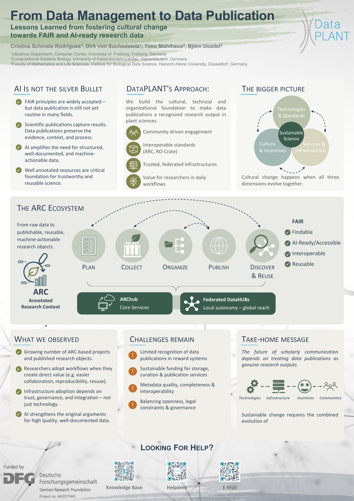

<figcaption style="text-align: center; font-size: 0.9em">
The poster "From Data Management to Data Publication", presented at the 1st nfdi4LS Conference in Gatersleben.
</figcaption>

The tools to store, version and share research data have matured. Yet in many disciplines, publishing data is still not part of everyday scientific practice. The barriers are cultural, organisational and tied to incentives rather than technical. With the poster [*From Data Management to Data Publication*](https://ipk-bit.github.io/ib2026-abstract-book/abstracts/posters/140/), DataPLANT looked back on its efforts to make data publication routine and shared the lessons learned at the [1st NFDI4LifeSciences Conference](https://meetings.ipk-gatersleben.de/nfdi4LS-IB2026/) at IPK Gatersleben in September. (Missed the conference? Our [wrap-up](https://nfdi4plants.github.io/news/2026-09-29-nfdi4ls-wrap-up/) covers the other DataPLANT contributions.)

## Beyond research data management

A central goal of DataPLANT is a cultural shift towards FAIR and AI-ready research data. That means looking beyond research data management (RDM) and treating data publication as an integral part of the scientific process. Data publications should count as genuine research outputs in their own right, not as an afterthought to a journal article.

DataPLANT's technical answer is the [Annotated Research Context (ARC)](https://nfdi4plants.org/nfdi4plants.knowledgebase/). It packages data, metadata, workflows and provenance in one version-controlled research object, is compatible with RO-Crate, and is supported by the ARChub and a federated network of DataHUBs.

## Why AI raises the stakes

The growing relevance of AI is changing how we talk about research data. Machine learning only works with data that are well documented and machine-actionable. Data that are published with rich, structured metadata are the data that AI-driven research can actually use. That makes good data publication more valuable, not less.

## Building the ecosystem

Technology alone will not make data publication routine, so DataPLANT keeps expanding its collaboration with infrastructure providers, funding initiatives and other NFDI consortia. Current activities include:

- making DataPLANT services more visible and interoperable through community-recognised registries such as [re3data](https://www.re3data.org/) and [DFG-RIsource](https://risources.dfg.de/) (the ARChub is [already listed there](https://risources.dfg.de/detail/RI_00659_de.html)),
- supporting the development of data-oriented core facilities,
- contributing to collaborative storage infrastructure initiatives, and
- promoting federated approaches to scalable and sustainable data publication.

## What still holds us back

Our experience shows that mandates are not enough. Researchers adopt data publication when they gain direct value from it, and when they trust the institutions and infrastructures behind it. Some obstacles remain:

- academic reward systems that still favour journal articles over data publications,
- the lack of long-term funding for research infrastructures, and
- persistent problems with metadata quality.

## Looking ahead

We are convinced that the future of scholarly communication will depend on recognising data publications as research outputs in their own right. Getting there requires technologies, infrastructures, incentives and community practices to evolve together. DataPLANT will keep working on all four.

*The poster was authored by Dirk von Suchodoletz (University of Freiburg), Björn Usadel (Forschungszentrum Jülich), Timo Mühlhaus (RPTU Kaiserslautern-Landau) and Cristina Schmale Rodrigues (University of Freiburg). Read the full abstract in the [conference abstract book](https://ipk-bit.github.io/ib2026-abstract-book/abstracts/posters/140/).*
