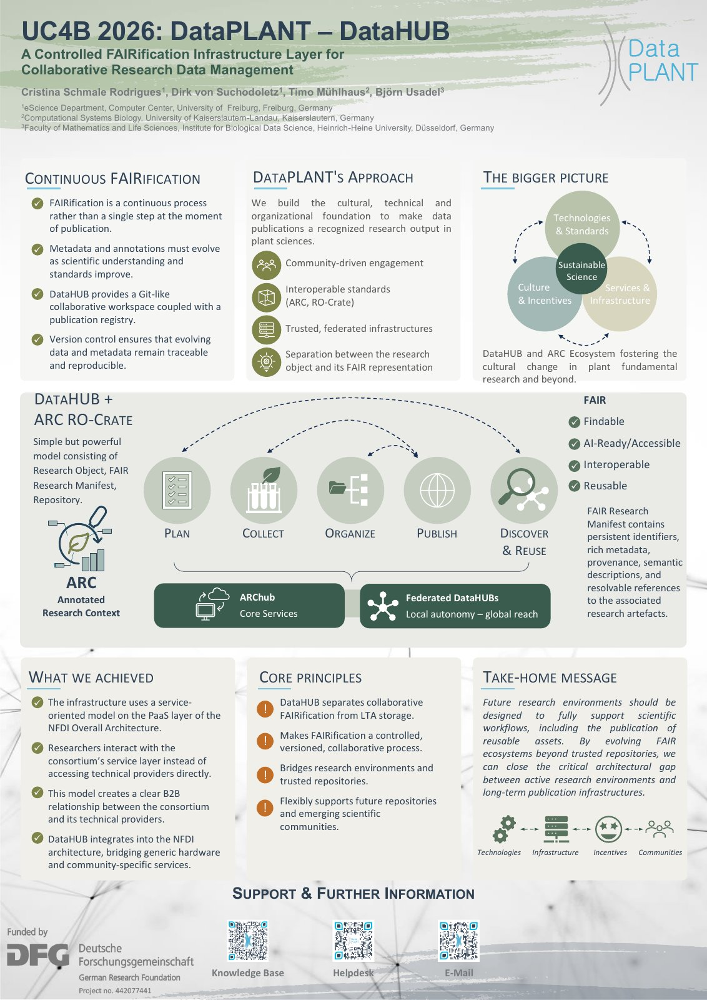
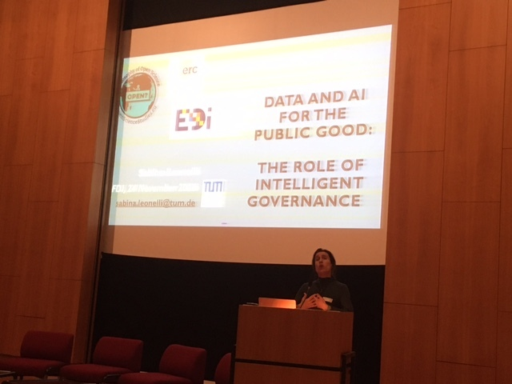

<figcaption style="text-align: center; font-size: 0.9em">
The DataPLANT poster presented at UC4B 2026 in Berlin.
</figcaption>

On 24 and 25 November 2026, the [third Base4NFDI User Conference (UC4B 2026)](https://events.gwdg.de/event/1337/) brought Base4NFDI and the wider National Research Data Infrastructure (NFDI) community together at the Berlin State Library (Staatsbibliothek zu Berlin). DataPLANT used the occasion to present DataHUB, its infrastructure that bridges collaborative research data management and the publication of FAIR research outputs.

## Two days of exchange in Berlin

Over two days, participants shared experiences, explored opportunities for collaboration and discussed shared services for research data management (RDM). The programme combined hands-on sessions, presentations from Base4NFDI incubator projects and poster contributions with strategic discussions, for example on sustainable operating models for basic services.

<figcaption style="text-align: center; font-size: 0.9em">
Sabina Leonelli (TUM) speaking on "Data and AI for the Public Good: The Role of Intelligent Governance".
</figcaption>

## DataHUB: continuous FAIRification

With the poster [*DataHUB: A Controlled FAIRification Infrastructure Layer for Collaborative Research Data Management*](https://events.gwdg.de/event/1337/contributions/5324/), DataPLANT showed how [DataHUB](/arc-data-hub) combines a Git-based collaborative workspace with a publication registry. Researchers jointly manage research data and metadata under version control. FAIRification thus becomes a continuous process throughout the research lifecycle rather than a single step at the moment of publication. Data, metadata, provenance and semantic annotations evolve together and remain traceable and reproducible.

## Publishing a FAIR representation, not just a dataset

A central concept is the separation of the research object from its FAIR representation. Rather than publishing datasets directly, DataHUB publishes a machine-actionable *FAIR Research Manifest*: a description of the research object inspired by the [ARC](https://nfdi4plants.org/nfdi4plants.knowledgebase/) and RO-Crate. The manifest brings together persistent identifiers, rich metadata, provenance information, semantic descriptions and resolvable references to the associated research artefacts. It serves as a stable, citable representation of the research object, independent of where the underlying data are stored.

Because DataHUB separates collaborative FAIRification from long-term archiving, it can bridge active research environments and trusted repositories, and stays flexible for future repositories and new scientific communities.

## Beyond plant research

UC4B was an excellent opportunity to showcase DataHUB as an established and actively used service, to exchange ideas with other NFDI initiatives and to explore its potential beyond its original focus on fundamental plant research. These discussions support DataPLANT's efforts to make its infrastructure and experience available to a broader range of research communities.

*The poster was authored by Cristina Schmale Rodrigues and Dirk von Suchodoletz (University of Freiburg), Timo Mühlhaus (RPTU Kaiserslautern-Landau) and Björn Usadel (Heinrich Heine University Düsseldorf). Find the contribution in the [UC4B 2026 programme](https://events.gwdg.de/event/1337/contributions/5324/).*
